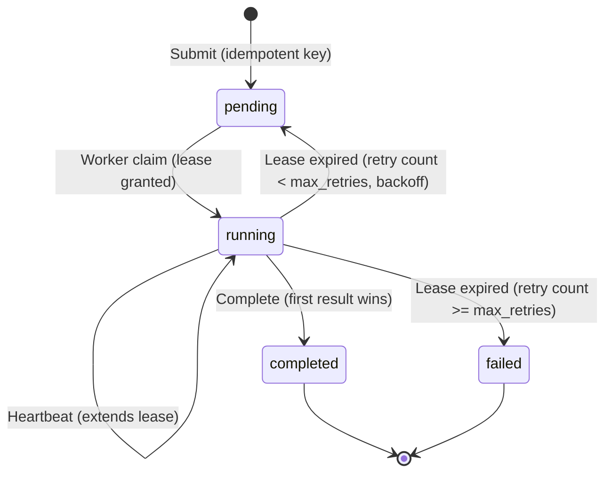

# Crash-Resilient Task Queue

A minimal, crash-resilient task queue that guarantees every job reaches a terminal state (`completed` or `failed`) with exactly-once execution semantics for deterministic workloads.

---

## State Diagram

---

## Failure Recovery Matrix

| Failure Scenario | System Behavior & Invariant Guarantee |
| :--- | :--- |
| **Worker killed mid-execution** | Coordinator sweeper detects missing heartbeat / lease expiration. Requeues job with exponential backoff until max retries. |
| **Worker killed after writing result, before ACK** | Subsequent worker rerun recomputes or validates result. Completion is idempotent; first completion wins. |
| **Slow worker finishes after lease expiration** | New worker has claimed the job. Late worker's completion request is rejected as stale (fenced by lease/owner check). Result remains single and correct. |
| **Coordinator crashes and restarts** | All state resides in SQLite on disk with WAL mode enabled. On restart, sweeper resumes inspection of active leases. |
| **Duplicate job submissions** | Unique idempotency key returns existing job ID without creating a duplicate job. |
| **Poison pill job (always crashes worker)** | Every claim increments the attempt counter. Job transitions to `failed` upon exceeding `max_retries` (default: 3). |
| **Coordinator overload (high queue depth)** | API enforces queue depth limits and returns `429 Too Many Requests` (backpressure). |

---

## System Limits & Specifications

- **Default Lease Duration**: 10 seconds
- **Heartbeat Interval**: 3 seconds
- **Max Retries**: 3
- **Backoff Policy**: Exponential backoff between retries ($2^{\text{try}} \times \text{base\_delay}$)
- **Backpressure**: Max pending jobs threshold triggers HTTP 429
- **Storage**: SQLite (coordinator state) + filesystem/table (result store)
