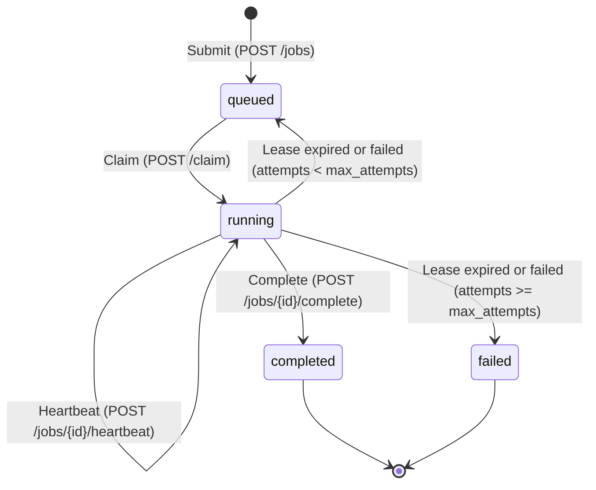

# Crash-resilient task queue

A background task queue that coordinates work between an HTTP API and independent workers. It guarantees that every submitted job reaches either completed or failed, even when workers crash, networks drop, or the coordinator restarts.

Run it directly with Python 3:

```bash
uvicorn coordinator.main:app --port 8000
python -m worker.worker --coordinator http://127.0.0.1:8000 --run-once
```

---

## Why this exists

Applications need to run slow tasks outside web request cycles. A worker process claims a job, executes the work, and reports completion back to a central coordinator.

Distributed systems face one core problem: a coordinator cannot distinguish between a worker that crashed and one that is running slowly over an interrupted network. Both look identical from the outside. If the coordinator assumes a silent worker is dead and hands the job to a second worker, both workers may run the same job. This system accepts that jobs may run more than once, but ensures through database constraints that only the first finished result is stored.

## How it works in plain words

Consider an example of processing 100 text files with two workers named Worker A and Worker B.

A client submits 100 jobs to the coordinator over HTTP. Worker A claims job 1, receiving a temporary lease (a timed ownership pass). While processing file 1, Worker A periodically sends a heartbeat (a short ping message) to tell the coordinator that it is still alive. Worker B claims job 2 and does the same.

At file 50, Worker A loses power. Its heartbeats stop. The coordinator runs a background sweeper thread that inspects the database. When Worker A's lease expires without a heartbeat, the sweeper resets job 50 back to queued status with a short delay. Worker B finishes its current file, requests work, claims job 50, and completes it.

If Worker A comes back online and tries to submit results for job 50, the database rejects the submission because Worker B already completed the job. All 100 files finish with exactly one stored result per job.

## Quick start

Start the coordinator:

```bash
uvicorn coordinator.main:app --port 8000
```

In a second terminal, submit a job:

```bash
curl -X POST http://127.0.0.1:8000/jobs \
  -H "Content-Type: application/json" \
  -H "Idempotency-Key: demo-key-1" \
  -d '{"type": "count_words", "payload": "hello world"}'
```

Output:
```json
{"job_id":1}
```

Run a worker for one job:

```bash
python -m worker.worker --coordinator http://127.0.0.1:8000 --run-once
```

Output:
```text
Worker worker-12548 complete response for job 1: updated=True
```

Check the job status and stored result:

```bash
curl http://127.0.0.1:8000/jobs/1
```

Output:
```json
{"id":1,"idem_key":"demo-key-1","type":"count_words","payload":"hello world","status":"completed","attempts":1,"max_attempts":3,"lease_owner":"worker-12548","lease_expires_at":1793258736.37,"not_before":1793258705.52,"error":null,"result":"2","created_at":1793258705.52,"updated_at":1793258706.38}
```

## Job lifecycle



A client posts a payload with an idempotency key, creating a [job](#glossary) in the `queued` state. An idle [worker](#glossary) calls `/claim` to claim the job, which advances the status to `running`, increments [attempt](#glossary), and sets an initial [lease](#glossary). While executing, the worker's background thread sends a [heartbeat](#glossary) to extend the lease deadline. When work finishes, the worker posts the result to `/complete`, which commits status `completed` in an atomic [transaction](#glossary). If the worker crashes or reports an error, the [sweeper](#glossary) evaluates the failure. If attempts are below `max_attempts`, the sweeper returns the job to `queued` with an exponential [retry and backoff](#glossary) delay plus random [jitter](#glossary). When attempts reach `max_attempts`, the sweeper sets status `failed`. The coordinator accepts only the first completion to commit, discarding late completions.

## Failure scenarios

| Failure scenario | System behavior | Automated test |
| :--- | :--- | :--- |
| Worker killed mid-job | Sweeper detects expired lease, increments attempts, and requeues job with backoff. | `tests/test_faults.py::test_crash_mid_job` |
| Worker killed after computation before ACK | Sweeper requeues job. Next worker re-runs handler and saves result. Database updates only if status is queued or running. | `tests/test_faults.py::test_crash_after_write_before_ack` |
| Stalled worker with expired lease | Replacement worker claims job. When original worker completes later, coordinator rejects update with `updated: false`. | `tests/test_faults.py::test_slow_worker_heartbeat_off` |
| Coordinator killed with SIGKILL and restarted | Worker catches network errors, pauses, and retries. Survives restart and completes job once database reopens. | `tests/test_faults.py::test_kill_coordinator_and_recover` |
| Duplicate job submission | Coordinator checks unique database index and returns existing job ID with HTTP 200. | `tests/test_faults.py::test_submit_idempotency_key_twice` |
| Handler always crashes | Each claim increments attempts counter. Sweeper transitions status to `failed` upon reaching `max_attempts`. | `tests/test_faults.py::test_always_crash_reaches_failed` |
| Overloaded queue depth | New submissions return HTTP 429 with `Retry-After: 5`. Known idempotency keys return HTTP 200. | `tests/test_faults.py::test_backpressure_max_queue` |
| Missing or bad worker token | Coordinator rejects request with HTTP 401 via constant-time token comparison. | `tests/test_auth.py::test_no_token_or_bad_token_on_worker_endpoint_returns_401` |
| Worker token used with wrong worker ID | Coordinator rejects claim or completion with HTTP 403 because token does not match payload identity. | `tests/test_auth.py::test_valid_token_wrong_worker_id_returns_403` |
| Worker token on client endpoints | Worker tokens cannot call `POST /jobs` or `GET /jobs/{id}` and receive HTTP 401. | `tests/test_auth.py::test_worker_token_on_client_endpoints_rejected` |
| Worker connects with invalid CA certificate | Worker catches TLS error and retries without crashing or bypassing verification. | `tests/test_auth.py::test_wrong_ca_cert_worker_does_not_crash` |

## Design decisions

Claim and lease:
- Chosen: Single-statement `UPDATE ... RETURNING` in SQLite with a timed [lease](#glossary) and [heartbeat](#glossary) background thread.
- Rejected: Two-step `SELECT` then `UPDATE`, and permanent worker assignments without leases.
- Reason: Two-step queries cause race conditions without explicit transaction locks. Permanent assignment leaves jobs abandoned when workers crash. Timed leases allow automatic recovery.

Idempotency:
- Chosen: Unique database constraint on `idem_key`. Submissions with existing keys return HTTP 200 with the existing job ID. Completion returns `updated: true` on the first commit and `updated: false` on repeats.
- Rejected: In-memory hash sets and client-generated random IDs without database uniqueness.
- Reason: In-memory structures disappear when the coordinator restarts. Database-backed keys prevent duplicate records across process lifecycles.

Retries:
- Chosen: Exponential delay ($BASE \times 2^{attempts} + jitter$) calculated in SQL with an attempt cap (`max_attempts`).
- Rejected: Immediate retries and fixed retry intervals handled in application loops.
- Reason: Immediate retries overload failing downstream services. Computing backoff and jitter directly in SQL avoids pulling rows into Python memory.

Backpressure:
- Chosen: Count only `queued` jobs against `MAX_QUEUE`. Return HTTP 429 with `Retry-After: 5` on new keys, but allow existing keys to return HTTP 200.
- Rejected: Counting `running` jobs toward the queue limit, or rejecting retries of known idempotency keys.
- Reason: Running jobs are actively being processed, not waiting in line. Rejecting known keys would punish clients for retrying dropped network connections.

Storage:
- Chosen: SQLite with [WAL](#glossary) mode, `PRAGMA synchronous = NORMAL`, and thread-local connections. Results stored directly in the `jobs.result` column.
- Rejected: External database servers and storing job results only on the local worker filesystem.
- Reason: SQLite requires no external server process. Storing results in SQLite allows workers on separate machines to write back to a central store.

Authentication:
- Chosen: Shared secret tokens stored in a JSON file and checked with `hmac.compare_digest`. Client and worker roles use separate tokens. Network traffic runs over HTTPS.
- Rejected: Mutual TLS (mTLS) with client certificates and single shared passwords for all endpoints.
- Reason: Constant-time comparison prevents timing attacks without the overhead of maintaining a client certificate authority. Role separation stops workers from submitting arbitrary jobs.

## Configuration

| Environment variable | Default | Meaning |
| :--- | :--- | :--- |
| `DB_PATH` | `jobs.db` | File path to SQLite database |
| `SQLITE_SYNCHRONOUS` | `NORMAL` | SQLite disk synchronization mode |
| `SWEEP_SECS` | `2` | Seconds between sweeper checks for expired leases |
| `LEASE_SECS` | `30` | Seconds granted to a worker on claim or heartbeat |
| `BASE_BACKOFF` | `2.0` | Base delay in seconds multiplied by $2^{attempts}$ for retries |
| `MAX_QUEUE` | `100` | Maximum queued jobs before coordinator returns HTTP 429 |
| `MAX_RESULT_BYTES` | `65536` | Maximum allowed size in bytes for a job result (64 KB) |
| `TOKENS_FILE` | None | File path to JSON dictionary of worker tokens |
| `CLIENT_TOKEN` | None | Secret bearer token required for client endpoints |
| `COORDINATOR_URL` | `http://127.0.0.1:8000` | Coordinator base URL for worker connections |
| `WORKER_ID` | `worker-<pid>` | Worker identifier string sent in claim and heartbeat payloads |
| `WORKER_TOKEN` | None | Bearer token sent by worker in Authorization header |
| `CA_CERT` | None | File path to CA certificate for TLS verification |
| `HEARTBEAT` | `on` | Set to `off` to disable worker heartbeat thread |
| `CRASH_AT` | None | Fault injection point (`after_claim`, `mid_job`, `after_compute_before_ack`) |
| `OUTPUTS_DIR` | `outputs` | Directory where file handlers write local copies |
| `JOB_SLEEP` | `10` | Sleep duration in seconds for sleep handler |
| `CLAIM_LOG` | None | File path where worker appends claim latency timings |

## Running the tests

Run the test suite with pytest:

```bash
pytest -v
```

All 31 automated tests passed on Python 3.13.9 in 65.35 seconds.

## Performance

Full profiling records, query execution plans, and benchmarks are recorded in [PERF.md](PERF.md).

Benchmarks were measured with `scripts/bench.py` on Windows using SQLite 3.51.0, processing 500 jobs across 2 workers with `JOB_SLEEP=0`.

| Metric | Baseline before optimization | Optimized after optimization | Change |
| :--- | :--- | :--- | :--- |
| Throughput | 65.5 jobs/s | 139.8 jobs/s | +113% speedup (2.13x faster) |
| Duration | 7.64 s | 3.58 s | -53.1% elapsed time |
| Claim latency p50 | 2.76 ms | 1.91 ms | -30.8% latency reduction |
| Claim latency p95 | 14.39 ms | 15.65 ms | Stable under doubled throughput |
| Non-test source lines | 1030 lines | 998 lines | -32 lines reduced |

## Limits

- **Warning:** Outside side effects cannot be rolled back. The system provides [at-least-once delivery](#glossary). If a job triggers an external side effect like charging a payment or sending an email before crashing, that outside action cannot be undone by the database.
- Single coordinator: The coordinator runs as a single process. It does not provide multi-node coordinator failover.
- Single-writer SQLite: SQLite allows concurrent readers in WAL mode, but only one write transaction at a time. Throughput is limited by SQLite write lock contention.
- Self-signed certificates: The provided TLS setup generates local self-signed certificates and does not handle automated public certificate authority renewal.

## Glossary

- job: A discrete unit of work defined by an ID, type, and payload (for example, job 1 with type count_words and payload "hello").
- coordinator: The central HTTP service managing the job database, API requests, leases, and sweeper.
- worker: An independent process that polls the coordinator, claims jobs, executes handlers, and reports results.
- lease: A timed reservation granted by the coordinator to a worker, preventing other workers from claiming the same job until the deadline passes.
- heartbeat: A periodic HTTP request sent by a working worker to extend its lease expiration before the coordinator considers it dead.
- sweeper: A background thread on the coordinator that periodically scans the database for expired leases and requeues or fails them.
- claim: An atomic database operation where a worker acquires an available queued job and receives a lease.
- attempt: A counter tracking how many times a job has been claimed or retried.
- retry and backoff: A recovery policy that delays re-running a failed job, multiplying the wait time exponentially after each failed attempt.
- jitter: A random delay added to the retry backoff to stop multiple workers from retrying simultaneously.
- idempotency: A property where performing an operation multiple times produces the exact same outcome as running it once.
- at-least-once delivery: A guarantee that every job will be processed to completion, even if a failure causes it to be executed more than once.
- backpressure: A flow-control mechanism where the coordinator rejects new submissions with HTTP 429 when queue depth exceeds MAX_QUEUE.
- transaction: A group of database operations that execute as an atomic all-or-nothing unit.
- WAL: Write-Ahead Logging, an SQLite mode where writes append to a separate log file, allowing concurrent reads while writes take place.
- bearer token: A security string passed in the HTTP Authorization header proving the caller has permission to act as a worker or client.
- TLS: Transport Layer Security, cryptographic protocol providing encrypted HTTPS communication between workers and the coordinator.

## Future work (not built)

- Multiple coordinators with PostgreSQL and SKIP LOCKED
  - Why: Remove the single-coordinator availability bottleneck and single-writer disk lock.
  - Design change: Replace SQLite connection logic with PostgreSQL connection pools and query queues with `FOR UPDATE SKIP LOCKED`.
- Job cancellation endpoint
  - Why: Allow clients to abort long-running or obsolete jobs before or during execution.
  - Design change: Add `DELETE /jobs/{id}` or `POST /jobs/{id}/cancel`, update status to `canceled`, and make heartbeat responses instruct workers to stop.
- Priority queues and scheduled jobs
  - Why: Enable urgent jobs to jump the queue and allow jobs to run at specific future timestamps.
  - Design change: Add a `priority` integer column and sort claims by `priority DESC, not_before ASC, id ASC`.
- Metrics endpoint for Prometheus
  - Why: Monitor queue depth, failure rates, and claim latency over time in production.
  - Design change: Add `GET /metrics` exposing counter and histogram metrics without requiring SQLite queries on every scrape.
- Inspection endpoint for failed jobs
  - Why: Help operators inspect error traces and manually retry poisoned jobs without database access.
  - Design change: Add `GET /jobs?status=failed` and `POST /jobs/{id}/retry` to reset attempts to zero.
- Large result offloading to object storage
  - Why: Prevent database bloat when job results exceed 64 KB.
  - Design change: Workers upload large outputs to S3 or Google Cloud Storage and store only the resulting URI in `jobs.result`.
- Mutual TLS and token rotation
  - Why: Authenticate workers at the transport layer and rotate secrets without restarting the coordinator.
  - Design change: Configure uvicorn with client CA validation and add file-watch reloading for worker token files.
