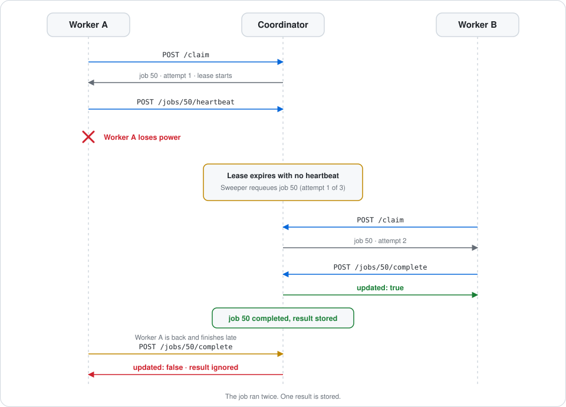
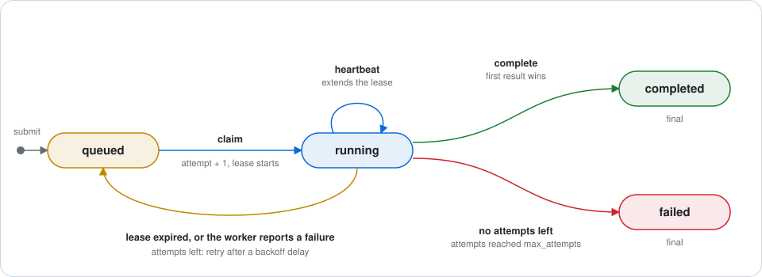

<h1 align="center">Crash-resilient task queue</h1>

<p align="center">
A job queue where every job ends as <code>completed</code> or <code>failed</code>,<br>
even when a worker dies, the network drops, or the coordinator restarts.
</p>

<p align="center">
<a href="#quick-start">Quick start</a> ·
<a href="#how-it-works">How it works</a> ·
<a href="#what-happens-when-things-break">Failure tests</a> ·
<a href="#design-decisions">Design decisions</a> ·
<a href="#glossary">Glossary</a>
</p>

<p align="center">
  
</p>

## The problem

Slow work should not run inside a web request. So a client submits a job, a separate worker runs it, and a central coordinator keeps track of it.

The hard part is a silent worker. If a worker stops responding, the coordinator cannot tell whether it crashed or is just slow. Both look the same from outside. If the coordinator gives the job to a second worker, the job may run twice.

This project accepts that a job can run twice. It guarantees two things instead: only the first finished result is stored, and every job ends in a final state.

## Quick start

Needs Python 3. Tested on 3.13.9.

```bash
pip install -r requirements.txt
uvicorn coordinator.main:app --port 8000
```

In a second terminal, submit a job:

```bash
curl -X POST http://127.0.0.1:8000/jobs \
  -H "Content-Type: application/json" \
  -H "Idempotency-Key: demo-key-1" \
  -d '{"type": "count_words", "payload": "hello world"}'
```

```json
{"job_id":1}
```

Run a worker for one job:

```bash
python -m worker.worker --coordinator http://127.0.0.1:8000 --run-once
```

```text
Worker worker-12548 complete response for job 1: updated=True
```

Read the job back:

```bash
curl http://127.0.0.1:8000/jobs/1
```

```json
{"id":1,"idem_key":"demo-key-1","type":"count_words","payload":"hello world","status":"completed","attempts":1,"max_attempts":3,"lease_owner":"worker-12548","lease_expires_at":1793258736.37,"not_before":1793258705.52,"error":null,"result":"2","created_at":1793258705.52,"updated_at":1793258706.38}
```

With no tokens configured, the API is open. For a setup with tokens and HTTPS, see [Running with tokens and HTTPS](#running-with-tokens-and-https).

## How it works

<p align="center">
  
</p>

Two workers share a pile of jobs. Here is what happens when one of them dies.

1. A client submits jobs. Each one gets an ID and starts as `queued`.
2. Worker A asks for work and gets job 50. It also gets a [lease](#glossary): a timed pass that says the job is A's until the time runs out.
3. While it works, A sends [heartbeats](#glossary). Each one extends the lease.
4. A loses power. The heartbeats stop.
5. The lease runs out. A background thread, the [sweeper](#glossary), puts job 50 back in the queue after a short wait.
6. Worker B claims job 50, finishes it, and sends the result. The coordinator stores it.
7. A comes back and sends its own result, late. The coordinator ignores it, because job 50 is already `completed`.

<p align="center">
  
</p>

Job 50 ran twice, and one result is stored. Two rules make that work:

- Completion succeeds only once. The update applies only while the job is `queued` or `running`, so the first result wins.
- The coordinator stores results itself, in the `jobs.result` column. A retry on any machine writes to the same place.

### Job lifecycle

<p align="center">
  
</p>

An [attempt](#glossary) is counted when a job is claimed, not when it fails. A job that crashes its worker still uses up an attempt, so a bad job cannot loop forever. After `max_attempts` (3 by default) the job becomes `failed`.

### API

| Endpoint | Caller | Purpose |
| :--- | :--- | :--- |
| `POST /jobs` | client | Submit a job. Needs an `Idempotency-Key` header. |
| `GET /jobs/{id}` | client | Read status, attempts, and result. |
| `POST /claim` | worker | Take the next queued job and start a lease. |
| `POST /jobs/{id}/heartbeat` | worker | Extend the lease. |
| `POST /jobs/{id}/complete` | worker | Report a result. The first one wins. |
| `POST /jobs/{id}/fail` | worker | Report a handler error. Retry or mark `failed`. |

## What happens when things break

Each case has an automated test that causes the failure for real. Fault tests are in `tests/test_faults.py`. Auth tests are in `tests/test_auth.py`.

### Crashes and slow workers

- **Worker killed mid-job.** The sweeper sees the expired lease, counts the attempt, and requeues the job with a backoff delay.
  Test: `test_crash_mid_job`
- **Worker killed after computing, before reporting.** The sweeper requeues the job and the next worker runs it again. One result is stored, because completion only applies while the job is `queued` or `running`.
  Test: `test_crash_after_write_before_ack`
- **Worker is slow, not dead.** Its lease expires and another worker takes the job. When the slow worker finishes, the coordinator answers `updated: false`.
  Test: `test_slow_worker_heartbeat_off`
- **Coordinator killed with SIGKILL, then restarted.** Workers catch the network errors, wait, and retry. Once the database reopens, the job completes once.
  Test: `test_kill_coordinator_and_recover`

### Duplicates and overload

- **Same job submitted twice.** A unique index on the idempotency key returns the existing job ID with HTTP 200.
  Test: `test_submit_idempotency_key_twice`
- **Handler always crashes.** Every claim uses up an attempt. At `max_attempts` the job becomes `failed`.
  Test: `test_always_crash_reaches_failed`
- **Jobs arrive faster than workers finish.** New submissions get HTTP 429 with `Retry-After: 5`. A key the system already knows still gets HTTP 200.
  Test: `test_backpressure_max_queue`

### Security

- **Missing or wrong worker token.** HTTP 401. Tokens are compared in constant time.
  Test: `test_no_token_or_bad_token_on_worker_endpoint_returns_401`
- **Worker token used with another worker's ID.** HTTP 403.
  Test: `test_valid_token_wrong_worker_id_returns_403`
- **Worker token used on client endpoints.** HTTP 401.
  Test: `test_worker_token_on_client_endpoints_rejected`
- **Worker has the wrong CA certificate.** The worker logs the TLS error and retries. It does not crash and does not skip verification.
  Test: `test_wrong_ca_cert_worker_does_not_crash`

## Design decisions

### Claim and lease

- Chosen: a single `UPDATE ... RETURNING` statement in SQLite, a timed lease, and a heartbeat thread in the worker.
- Rejected: a separate `SELECT` then `UPDATE`, and permanent job assignment with no lease.
- Why: with two steps, two workers can read the same row before either writes. Permanent assignment strands a job when its worker dies. A lease lets the system recover on its own.

### Idempotency

- Chosen: a unique constraint on `idem_key`. Submitting a known key returns the existing job. `complete` returns `updated: true` the first time and `updated: false` after that.
- Rejected: an in-memory set of seen keys, and random client-generated IDs with no database check.
- Why: memory is lost when the coordinator restarts. A database constraint holds across restarts.

### Retries

- Chosen: exponential backoff (`BASE_BACKOFF * 2^attempts`) plus random jitter, computed in SQL, with a cap at `max_attempts`.
- Rejected: instant retries, and fixed intervals handled in a Python loop.
- Why: instant retries hit a failing service again and again. Doing the math in SQL means rows never have to be pulled into Python.

### Backpressure

- Chosen: only `queued` jobs count toward `MAX_QUEUE`. A new key over the limit gets HTTP 429 with `Retry-After: 5`. A known key still gets HTTP 200.
- Rejected: counting `running` jobs toward the limit, and rejecting retries of known keys.
- Why: a running job is being worked on, not waiting. A client that retries after a dropped connection should not be punished for it.

### Storage

- Chosen: SQLite in [WAL](#glossary) mode with `PRAGMA synchronous = NORMAL` and one connection per thread. Results live in the `jobs.result` column.
- Rejected: a separate database server, and result files on each worker's local disk.
- Why: SQLite needs no extra process. Results in the database mean a worker on another machine can report back to one central store.

### Authentication

- Chosen: bearer tokens from a JSON file, checked with `hmac.compare_digest`. Workers and clients use different tokens. Traffic runs over HTTPS.
- Rejected: mutual TLS, and one shared password for every endpoint.
- Why: tokens need no client certificate authority. Separate roles stop a worker from submitting jobs.

## Configuration

<details>
<summary>Environment variables</summary>

<br>

**Coordinator**

- `DB_PATH` (default `jobs.db`): path to the SQLite database.
- `SQLITE_SYNCHRONOUS` (default `NORMAL`): SQLite disk sync mode.
- `LEASE_SECS` (default `30`): seconds a worker gets on claim or heartbeat.
- `SWEEP_SECS` (default `2`): seconds between sweeper runs.
- `BASE_BACKOFF` (default `2.0`): base retry delay in seconds, multiplied by 2^attempts.
- `MAX_QUEUE` (default `100`): queued jobs allowed before the API returns 429.
- `MAX_RESULT_BYTES` (default `65536`): largest result accepted, 64 KB.
- `TOKENS_FILE` (default none): path to a JSON file of worker tokens.
- `CLIENT_TOKEN` (default none): bearer token required on client endpoints.

**Worker**

- `COORDINATOR_URL` (default `http://127.0.0.1:8000`): where the worker finds the coordinator.
- `WORKER_ID` (default `worker-<pid>`): name sent in claim and heartbeat requests.
- `WORKER_TOKEN` (default none): bearer token the worker sends.
- `CA_CERT` (default none): path to the CA certificate used to verify TLS.
- `OUTPUTS_DIR` (default `outputs`): folder where handlers write local copies.
- `CLAIM_LOG` (default none): file where the worker appends claim timings.

**Testing**

- `HEARTBEAT` (default `on`): set to `off` to stop the worker heartbeat thread.
- `CRASH_AT` (default none): fault injection point. One of `after_claim`, `mid_job`, `after_compute_before_ack`.
- `JOB_SLEEP` (default `10`): seconds the sleep handler waits.

</details>

### Running with tokens and HTTPS

Make a self-signed certificate. The address in `subjectAltName` must match the address workers connect to.

```bash
openssl req -x509 -newkey rsa:2048 -nodes -keyout key.pem -out cert.pem \
  -days 30 -subj "/CN=coordinator" -addext "subjectAltName=IP:<coordinator-ip>"
```

Create `tokens.json`, one entry per worker:

```json
{"w1": "<long-random-string>"}
```

Start the coordinator:

```bash
TOKENS_FILE=tokens.json CLIENT_TOKEN=<client-secret> \
  uvicorn coordinator.main:app --host 0.0.0.0 --port 8443 \
  --ssl-keyfile key.pem --ssl-certfile cert.pem
```

Start a worker on the other machine. Copy `cert.pem` to it first.

```bash
COORDINATOR_URL=https://<coordinator-ip>:8443 WORKER_ID=w1 \
WORKER_TOKEN=<token-for-w1> CA_CERT=cert.pem \
  python -m worker.worker
```

A token only works with its own worker ID. Keep `tokens.json` and `*.pem` out of git.

## Tests

```bash
pytest -v
```

Last full run: 31 tests passed in 65.35 s on Python 3.13.9. The fault tests start real coordinator and worker processes and kill them mid-job.

## Performance

Measured with `scripts/bench.py`: 500 jobs, 2 workers, `JOB_SLEEP=0`, on Windows with SQLite 3.51.0. Query plans and profiling notes are in [PERF.md](PERF.md).

| Metric | Before | After | Change |
| :--- | ---: | ---: | ---: |
| Throughput | 65.5 jobs/s | 139.8 jobs/s | 2.13x |
| Total time | 7.64 s | 3.58 s | -53.1% |
| Claim latency, p50 | 2.76 ms | 1.91 ms | -30.8% |
| Claim latency, p95 | 14.39 ms | 15.65 ms | +8.8% |
| Source lines, non-test | 1030 | 998 | -32 |

Claim latency at p95 rose slightly while throughput doubled.

## Limits

> [!WARNING]
> Delivery is at-least-once. A job can run twice. If a job sends an email or charges a card before its worker crashes, the database cannot undo that. A handler that touches the outside world must be safe to run twice.

- One coordinator process. There is no failover.
- SQLite allows one writer at a time. WAL mode lets readers continue, but write throughput is capped by that lock.
- The TLS setup uses self-signed certificates. There is no automatic renewal.

## Glossary

- **job**: one unit of work, with an ID, a type, and a payload. Example: job 1, type `count_words`, payload `"hello world"`.
- **coordinator**: the central service. It owns the API, the database, the leases, and the sweeper.
- **worker**: a separate process that asks the coordinator for jobs, runs them, and reports results.
- **claim**: the atomic step where a worker takes a queued job and receives a lease.
- **lease**: a timed claim on a job. No other worker can take the job until the lease expires.
- **heartbeat**: a short request a working worker sends to extend its lease.
- **sweeper**: a background thread in the coordinator that finds expired leases and requeues or fails those jobs.
- **attempt**: a count of how many times a job has been claimed.
- **retry and backoff**: after a failure, the job waits before it runs again. The wait doubles with each attempt.
- **jitter**: a small random amount added to the backoff, so retries do not all land at the same moment.
- **idempotency**: doing something twice has the same effect as doing it once. Submitting the same key twice creates one job.
- **at-least-once delivery**: every job is run at least once, and sometimes twice.
- **backpressure**: the system pushes back on clients when jobs arrive faster than workers finish them. Here that means HTTP 429.
- **transaction**: a group of database steps that all happen or none do.
- **WAL**: write-ahead logging, an SQLite mode where readers are not blocked by a writer.
- **bearer token**: a secret string sent in the `Authorization` header to prove who is calling.
- **TLS**: the encryption behind HTTPS.

## Project layout

```text
coordinator/   HTTP API, database access, sweeper
worker/        worker loop, heartbeat, job handlers
tests/         fault tests and auth tests
scripts/       bench.py
assets/        diagrams used in this README
PERF.md        benchmark notes
```

## Where this is used

Any system that has work to do and many machines to do it on:

- **Email and notifications:** your app drops "send this email" into a queue, and workers send it.
- **Video and image processing:** uploading a video creates a job, and workers convert it.
- **CI/CD:** each build or test run is a job picked up by a runner.
- **Payments:** a failed webhook is retried, so the handler must not charge twice.
- **ML jobs:** training or inference tasks are handed out to available machines.

## Future work

- **Persistent storage:** keep jobs in Postgres or Redis so they survive a coordinator restart.
- **Worker heartbeats:** workers send a heartbeat so the coordinator spots dead ones faster than waiting for the claim timeout.
- **Dead-letter queue:** jobs that keep failing go to a separate queue instead of retrying forever.
- **Job priorities:** urgent jobs run before others.
- **Exponential backoff:** wait longer between each retry.
- **Worker authentication:** only trusted workers can claim jobs.
- **Metrics:** track queue size, retry count, and job time.