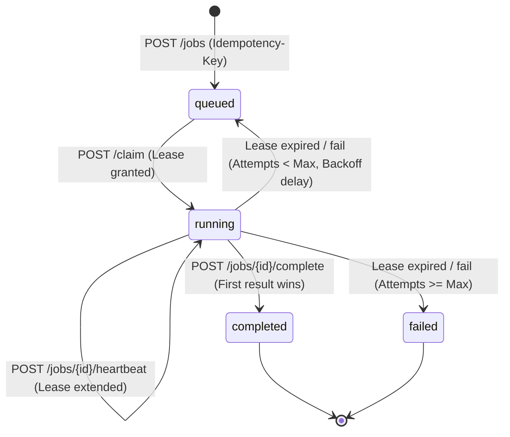

# Crash-Resilient Task Queue

A minimal, crash-resilient task queue that guarantees every job reaches a terminal state (`completed` or `failed`) with exactly-once execution semantics for deterministic workloads, even under worker crashes, coordinator restarts, network partitions, and queue overload.

---

## State Diagram



---

## Failure Recovery Matrix

| Failure Scenario | System Behavior & Invariant Guarantee |
| :--- | :--- |
| **Worker killed mid-job (`CRASH_AT=mid_job`)** | Sweeper detects missing heartbeat / lease expiration. Requeues job with exponential backoff delay (`BASE * 2^attempts + jitter`). |
| **Worker killed after computing before ACK (`CRASH_AT=after_compute_before_ack`)** | Job is requeued. Clean worker recomputes. Database sets `result` in atomic `UPDATE ... WHERE status IN ('queued', 'running')`. Only one result is stored. |
| **Slow / Stalled worker (`HEARTBEAT=off`)** | Job lease expires and is claimed by Worker B. If Worker A later finishes and attempts to complete, the database rejects the stale completion (`updated: false`). First completion wins. |
| **Coordinator killed (`kill -9`) & restarted** | Worker retries `/complete` across connection drops. Once coordinator restarts on the same SQLite database (WAL mode), the worker completes the job cleanly. |
| **Duplicate job submissions** | Submitting the same `Idempotency-Key` returns existing `job_id` (`200 OK` on duplicates, `201 Created` on new jobs). Retries are never penalized. |
| **Poison pill job (`always_crash`)** | Every claim increments `attempts`. Upon exceeding `max_attempts` (default 3), sweeper transitions status to `failed` with error message. |
| **Queue overload (`MAX_QUEUE` reached)** | Returns `429 Too Many Requests` with `Retry-After: 5` for new keys. Existing idempotency keys bypass backpressure and return `200`. |
| **Worker token mismatch / forgery** | Coordinator validates Bearer tokens via `hmac.compare_digest`. Valid token for `w1` used with worker ID `w2` returns `403 Forbidden`. |
| **TLS / SSL MITM protection** | Coordinator serves over HTTPS with SAN certificate. Workers strictly verify server cert against `CA_CERT` (`verify=False` is never allowed). |

---

## Security & Architecture

- **HTTPS & TLS**: Coordinator binds on `0.0.0.0` with `--ssl-keyfile` and `--ssl-certfile`. Workers connect with `--ca-cert` verification.
- **Worker Tokens**: Managed via `tokens.json` (mapped in `TOKENS_FILE`, ignored by git).
- **Client Tokens**: Distinct `CLIENT_TOKEN` required for job submission and status polling; worker tokens cannot submit jobs.
- **Result Storage**: Stored directly in `jobs.result` column (max 64 KB, larger payloads rejected with `413`).
- **Clock Authority**: Coordinator clock decides all lease expiries; workers do not perform time comparisons.

---

## System Configuration & Limits

| Environment Variable | Default | Purpose |
| :--- | :--- | :--- |
| `DB_PATH` | `jobs.db` | Path to SQLite database file |
| `LEASE_SECS` | `30` | Duration of worker lease before expiration |
| `SWEEP_SECS` | `2` | Interval for sweeper background thread |
| `BASE_BACKOFF` | `2.0` | Base exponential retry delay in seconds |
| `MAX_QUEUE` | `100` | Maximum queued jobs before triggering HTTP 429 |
| `MAX_RESULT_BYTES` | `65536` | Maximum allowed result size (64 KB) |
| `CLIENT_TOKEN` | - | Bearer token for client API operations |
| `TOKENS_FILE` | `tokens.json` | JSON mapping of worker IDs to secret tokens |
| `CA_CERT` | - | CA certificate path for worker TLS verification |

---

## Running the Automated Test Suite

```powershell
# Run all fault, authentication, database, and API tests
pytest -v
```
